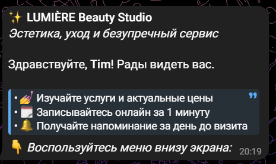
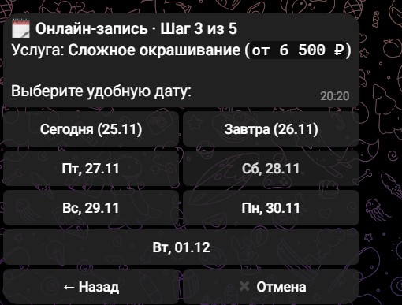

# LUMIÈRE Beauty Studio — Telegram Booking Bot

An asynchronous Telegram bot for a beauty salon built with **Python**, **python-telegram-bot (v21+)**, and **SQLite (`aiosqlite`)**. The bot enables clients to browse categorized services and prices, book appointments online with live time-slot availability, manage or cancel their bookings, and receive automated reminders 24 hours before their visit—while giving the salon administrator a dedicated `/admin` dashboard and real-time notifications.

---

## Features

### For Clients
- **Welcome & Navigation (`/start`, `/help`)**: Automatically registers or updates the client profile in SQLite, configures Telegram's bot command menu, and displays a persistent bottom reply keyboard (supports an optional `banner.jpg` welcome cover).
- **Interactive Service Catalog (`💅 Наши услуги`)**: Browse services organized by category (*Nail Care*, *Hair*, *Brows & Lashes*) using smooth in-message inline navigation (`edit_message_text`) with a direct button to start booking.
- **Step-by-Step Online Booking (`🗓 Записаться`)**:
  - 5-step guided `ConversationHandler` flow: *Category → Service → Date (next 7 days) → Available Time → Contact Info*.
  - Automatically hides already-booked slots and past time slots for the current day (with a 30-minute buffer).
  - Prevents double-booking at the database level via a partial unique SQLite index on active `(appointment_date, appointment_time)` pairs.
  - **Returning Client Recognition**: Detects previously saved name and phone number and offers one-tap reuse, or accepts Telegram contact sharing (`request_contact=True`) and manual phone input with validation.
- **My Bookings & Cancellation (`📋 Моя запись`)**: Displays active upcoming appointments with two-step cancellation confirmation that immediately frees the slot.
- **Studio Contacts (`📞 Связаться`)**: Displays studio address and phone number in tap-to-copy `<code>` format, working hours, and quick inline links to the map and manager chat.
- **Automated 24-Hour Reminders**: Background job checks upcoming active appointments every 60 seconds and sends a one-time reminder when <= 24 hours remain before the visit, complete with **Confirm Visit** and **Cancel Booking** buttons.

### For Administrators
- **Protected Admin Dashboard (`/admin`)**: Restricted by `ADMIN_ID` from `.env`, showing live counts for today's appointments, total upcoming appointments, and registered clients.
- **Schedule & Client Views**: View appointments for *Today*, *Tomorrow*, *All Upcoming*, or browse the *Client Directory* (name, username, phone, active and total booking counts).
- **Admin Cancellation**: Cancel any appointment directly from the dashboard; the client automatically receives a cancellation notice.
- **Real-Time Notifications**: Instant alerts sent to the administrator when a client creates a booking, cancels a booking, or confirms a visit from a 24-hour reminder.

---

## Tech Stack

- **Python 3.9+** (`asyncio`)
- **[python-telegram-bot[job-queue] >= 21.0](https://docs.python-telegram-bot.org/)** — Asynchronous Telegram Bot API framework & `APScheduler`-backed `JobQueue`
- **[aiosqlite](https://github.com/omnilib/aiosqlite)** — Asynchronous driver for SQLite
- **[python-dotenv](https://github.com/theskumar/python-dotenv)** — Environment variable loading from `.env`
- **SQLite** — Local relational database (`salon.db`, created automatically on startup)

---

## Project Structure

```text
.
├── handlers/
│   ├── __init__.py       # Handlers package initializer
│   ├── admin.py          # /admin dashboard, client directory, and admin cancellations
│   ├── booking.py        # Multi-step booking ConversationHandler and client cancellation flow
│   ├── menu.py           # /start, /help, interactive service catalog, contacts, and my bookings
│   └── reminders.py      # Background 24h reminder job and visit confirmation handler
├── .env.example          # Environment variables template
├── .gitignore            # Excludes .env, .venv, *.db, and Python cache files
├── bot.py                # Application entry point, handler registration, and JobQueue setup
├── config.py             # Config dataclass and environment validation
├── database.py           # Async SQLite Database class, schema initialization, and queries
└── keyboards.py          # Reply and Inline keyboard builders

```


---

## Screenshots

### Welcome Screen

The bot welcomes users and provides quick access to its main features.



### Main Menu

Users can browse services, make appointments, view their bookings, and contact the studio.


### Online Booking

Users can select a convenient date and continue the appointment booking process.



